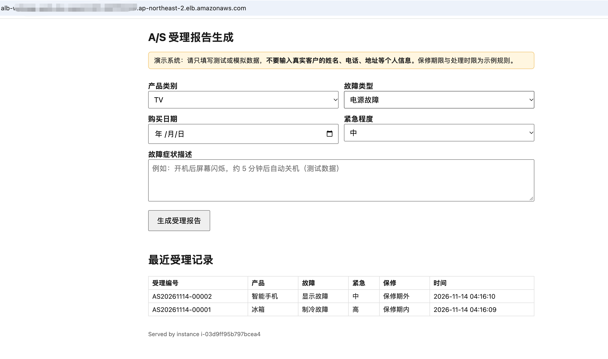
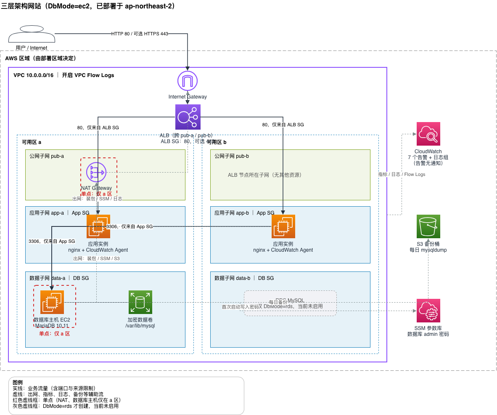

# A/S 受理报告生成：三层架构网站

客户提交 A/S（售后服务）请求时，自动生成受理报告草稿。网站按三层架构部署在 AWS，全部用 CloudFormation 创建，可用脚本重复部署和销毁。

> **只使用测试或模拟数据。** 表单不收集姓名、电话、地址，也不要输入真实客户信息。保修期限、处理时限、维修步骤都是**示例规则**（见 `app/report.py`），上线前必须换成真实政策。

## 功能
输入：产品类别（TV、冰箱、洗衣机、空调、智能手机）、故障类型（电源故障、噪声、制冷故障、显示故障、物理损坏）、购买日期、故障症状描述、紧急程度（高/中/低）。

输出：
- A/S 受理报告草稿（正式格式，带受理编号）
- 保修判定（保修期内/保修期外）
- 按紧急程度给出的处理优先级指导
- 预计维修步骤清单
- 一键复制报告；受理记录写入数据库，页面显示最近 10 条

报告由规则生成，不调用大模型（账号没有 Bedrock 权限），结果可测试、可复现。

## 截图


页面为 HTTP 访问；ALB 地址已打码。

## 架构


- 表现层：面向公网的 ALB，位于两个可用区的公网子网。
- 应用层：EC2 Auto Scaling（2–4 台），位于私有子网，nginx 提供页面，Python 服务提供 `/api/`。
- 数据层：EC2 自建 MariaDB，位于数据子网，数据放在独立加密卷，每天备份到 S3。可选 RDS（需要账号有 RDS 权限，未验证）。

设计说明见 [`docs/architecture.md`](docs/architecture.md)，可编辑图源文件见 `docs/architecture.drawio`。

## 快速开始
前置条件：AWS CLI v2 并已登录、`python3`；建议安装 `cfn-lint`（`pip install cfn-lint`）。

```bash
cd infra
./deploy.sh -n -r ap-northeast-2    # 只校验：应用测试 + cfn-lint + validate-template，不创建资源
./deploy.sh -r ap-northeast-2       # 部署 dev 环境，完成后输出 SiteUrl
```

部署后访问 `SiteUrl`。实例启动需要 1–3 分钟，期间可能返回 502，等 ALB 目标变为 healthy 即可。
参数、数据库模式、HTTPS、更新与回滚见 [`infra/README.md`](infra/README.md)。

本地测试应用逻辑（不需要 AWS）：

```bash
cd app && python3 -m unittest discover -s tests
```

## 清理（避免持续计费）
NAT Gateway、ALB 和 EC2 即使没有流量也按小时计费，不用时请删除：

```bash
cd infra
./destroy.sh -e dev -r ap-northeast-2    # 需输入栈名确认，拒绝 prod
```

删栈后仍会残留数据卷快照、S3 备份桶和两个 SSM 参数（`db/admin`、`db/app`），按 [`docs/ops-checklist.md`](docs/ops-checklist.md) 第 4 节逐项清理。

## 已知限制
- **只有 HTTP，没有 HTTPS**：当前账号无证书相关权限（ACM、IAM 服务器证书、CloudFront、Route 53），浏览器会提示“不安全”。拿到 ACM 证书后用 `./deploy.sh -c <证书ARN>` 启用（路径已在模板中，未部署验证）。
- **单点**：NAT 和数据库主机只在 a 区。备份每天一次（RPO 最长约 24 小时），尚未做恢复演练。
- **自建数据库，不是托管服务**：补丁、高可用、恢复都自己负责；应用与数据库之间未加密；没有数据库磁盘空间告警。
  - **为什么不用 RDS**：当前部署角色没有任何 RDS 权限（策略模拟显示隐式拒绝；创建 `DBSubnetGroup` 的真实调用也被拒绝）。Aurora 同属 RDS 接口，同样不可用；DynamoDB 的 `CreateTable` 也被拒绝。所以在不改账号权限的前提下，只能用 EC2 自建 MariaDB（MySQL 协议兼容）。
  - **不是技术偏好**：生产环境应优先用托管数据库（RDS Multi-AZ 或 Aurora），以获得自动补丁、自动备份和故障转移。模板已保留 RDS 路径（`DbMode=rds`），拿到权限后切换即可，但会替换数据库，需先迁移数据，且该路径尚未部署验证。
  - **为此付出的代价**：见 [`docs/architecture.md`](docs/architecture.md) 第 5、8 节（数据库单点、备份只有每日一次的逻辑备份、未做恢复演练）。
- 告警没有通知动作（账号无 SNS 权限）。

完整列表与未验证项见 [`docs/architecture.md`](docs/architecture.md) 第 8 节。

## 目录说明
| 路径 | 内容 |
|---|---|
| `app/` | A/S 应用：`report.py`（规则）、`server.py`（接口）、`index.html`（页面）、`tests/` |
| `infra/` | `template.yaml`（CloudFormation）、`deploy.sh`、`destroy.sh`、`iam/`（RDS 模式用的服务角色）、`README.md` |
| `docs/` | 设计说明、架构图（png/drawio）、运维清单、使用的 Skill |
| `images/` | 网站截图 `site-screenshot.png` |
| `scripts/` | `show-role-perms.sh`：只读查看 IAM 角色权限（输出含账号 ID，勿外传） |
| `.kiro/steering/` | 命名与标签规范（org=`kiro`，workload=`webapp`） |
| `.kiro/specs/` | 需求、设计、任务清单 |

## 安全与合规
- 代码、模板、文档中没有密钥或密码。数据库密码由实例启动时随机生成，存入 SSM SecureString；应用使用只有一张表 SELECT/INSERT 权限的独立账号。
- 数据库安全组只允许应用层访问 3306，没有对 `0.0.0.0/0` 开放 22、3389 或数据库端口；运维用 SSM Session Manager，没有 SSH。
- S3 桶全部开启“阻止所有公有访问”并加密。
- 提交截图和录屏前，遮挡账号 ID、IP、实例 ID 等信息。
