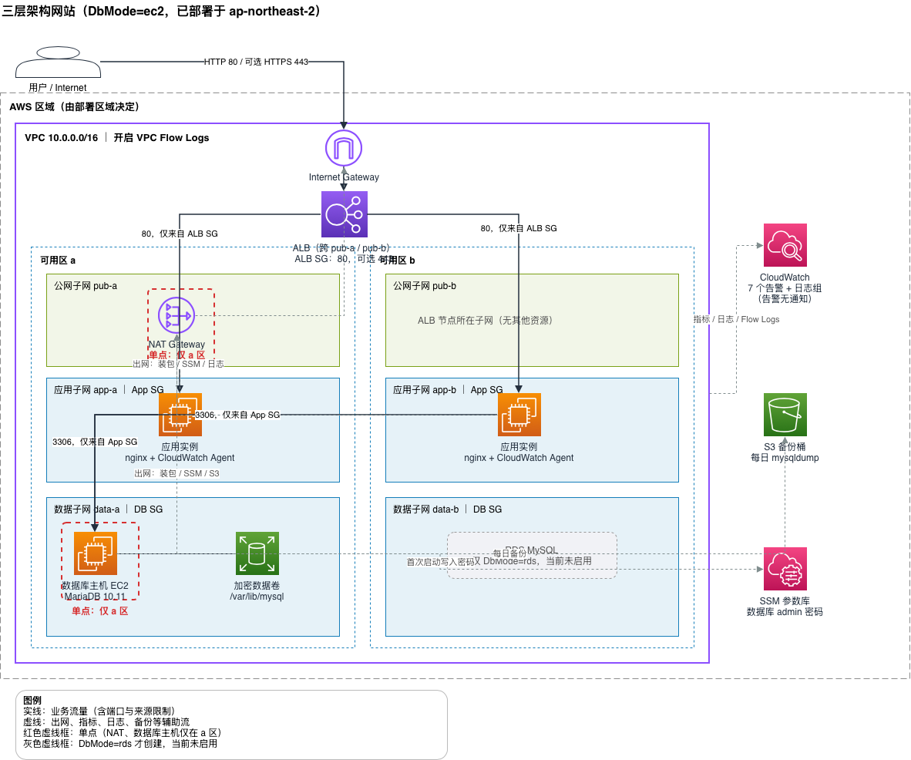

# 三层架构网站：架构图与设计说明

## 1. 目标与范围
在 AWS 上提供可水平扩展、数据层不暴露公网的三层网站。应用层用 nginx 静态页占位（显示实例 ID 与数据库端点），用来验证链路、扩缩容与监控；真实业务代码、自定义域名、WAF、CDN、CI/CD 不在本次范围。区域不固定，由 `deploy.sh` 按 `AWS::Region` 推导区域代码；命名与标签遵循 `.kiro/steering/` 规范（org=`kiro`，workload=`webapp`）。

## 2. 架构图

可编辑源文件：[`docs/architecture.drawio`](architecture.drawio)（用 draw.io / diagrams.net 或 VS Code 的 Draw.io 插件打开；修改后重新导出 `architecture.png`）。

图例与读图说明
- 实线：业务流量（含端口和来源限制）；虚线：出网、指标、日志、备份等辅助流。
- 红色虚线框：单点。NAT 只在 a 区；数据库主机只在 a 区。a 区故障时，应用层出网中断、数据库不可用。
- 灰色虚线框：`DbMode=rds` 时才创建的 RDS，当前部署未启用（账号无 RDS 权限）。当前 data-b 子网里没有资源，仅为将来 RDS 的子网组预留。
- ALB 是一个跨 pub-a 与 pub-b 的逻辑资源，图中画在两个可用区上方；两个应用实例分布在 a、b 两区。
- 安全组边界以子网标题中的 SG 名标注：ALB SG → App SG → DB SG，逐层只允许上一层访问。
- 告警目前没有通知动作（部署角色无 SNS 权限）。HTTPS 默认不启用，传入证书 ARN 后才会有 443。

## 3. 分层设计
- 表现层：Internet-facing ALB 位于两个公网子网。HTTP 健康检查 `/health`。传入 ACM 证书 ARN 后自动增加 443 监听（TLS1.3/1.2 策略），80 跳转 443。ALB 丢弃非法头；prod 开删除保护。
- 应用层：Launch Template + ASG（最小 2、最大 4，跨两个可用区），位于私有应用子网，经 NAT 出网。ELB 健康检查驱动替换；CPU 目标跟踪 50% 自动扩缩。无 SSH，运维走 SSM Session Manager。
- 数据层：由参数 `DbMode` 选择。
  - `ec2`（默认，当前部署）：数据子网中的一台 EC2（a 区）运行 MariaDB 10.11（MySQL 协议兼容）。数据放在独立的加密 gp3 数据卷（挂载 `/var/lib/mysql`，`DeletionPolicy: Snapshot`，实例替换后数据仍在）。首次启动时生成随机 `admin` 密码并存入 SSM SecureString `/{env}/webapp/{region}/db/admin`；systemd 定时器每天把 `mysqldump` 备份到 S3（带生命周期，默认 14 天）。数据子网增加经 NAT 的出站默认路由（装包、SSM、S3），仍无入站路径。**这是自建数据库，不是托管服务**：补丁、高可用、恢复演练都由我们负责。
  - `rds`：RDS MySQL，凭证由 RDS 托管，需要账号授予 RDS 权限（当前部署角色没有，因此未使用）。在两种模式间切换会替换数据库，需先迁移数据。

## 4. 网络与安全
- 三层 SG 链式引用：Internet →(80/443) ALB SG →(80) App SG →(3306) DB SG；入站没有 `0.0.0.0/0` 的非 Web 端口（出站为默认全放行）。
- 权限最小化：EC2 角色 = SSM 托管策略 + 仅限 nginx 日志组的写日志权限；不授予 Secrets Manager 权限（占位页不读密钥）。Flow Logs 角色限定服务主体，并带 `aws:SourceAccount` / `aws:SourceArn` 条件防混淆代理。
- 加密：EBS（含数据库数据卷）与 S3 备份桶静态加密；备份桶拒绝非 TLS 访问。数据库连接目前未启用 TLS（见第 8 节）。
- 部署权限：`DbMode=ec2`（当前部署）直接用部署者角色已有的 EC2/ELB/ASG/S3/SSM/IAM 角色权限，不需要服务角色。`DbMode=rds` 需要管理员一次性创建 CloudFormation 服务角色（`infra/iam/cfn-service-role.yaml`，权限限定在本 workload/环境/区域的命名范围内），部署者只需 `iam:PassRole`；该路径尚未实际部署验证。

## 5. 可用性
| 组件 | 现状 | 单点/风险 | 升级路径 |
|---|---|---|---|
| ALB / ASG | 跨 2 AZ | 无 | 提高最小实例数 |
| NAT | 1 个（a 区） | a 区故障时应用层无法出网（已有实例仍可服务 ALB 流量） | 每 AZ 一个 NAT + 每 AZ 一张应用路由表 |
| 数据库 | 单台 EC2（a 区）；RDS 模式默认单 AZ | a 区或主机故障即不可用 | 启用 RDS（`DbMultiAz=true`），或自建主从复制 |
| 数据备份 | 每天 03:00（UTC）一次 `mysqldump` 到 S3，保留 14 天；部署时额外生成一份 | RPO 最长约 24 小时；RTO 未评估，需先做恢复演练。数据卷只在删栈时才会留快照，没有定期快照 | 提高备份频率、增加 EBS 定期快照，或启用 RDS 自动备份 |

a 区整体故障时的表现：b 区的应用实例仍可通过 ALB 返回页面，但连不上数据库，也无法出网（装包、SSM）。数据卷在 a 区，恢复只能在 b 区重建数据库主机并从 S3 备份导入。

## 6. 监控
CloudWatch 告警：`DbMode=ec2`（当前部署）共 6 个：ALB 5xx、目标 5xx、不健康主机、ASG CPU、数据库主机 CPU、数据库主机状态检查；`DbMode=rds` 共 7 个，后两项换成 RDS CPU、剩余存储、连接数。告警目前只能在控制台查看，没有通知动作（部署角色无 SNS 权限）。nginx 访问/错误日志与 VPC Flow Logs 进入按规范命名的日志组（默认保留 14 天），两者都已确认有日志流写入。ASG 开启组指标。详见 `docs/ops-checklist.md`。

## 7. 成本
主要成本项：NAT Gateway（固定小时费 + 流量）、ALB、2 台 t3.micro、一台 t3.micro 数据库主机加 20 GiB 数据卷与 S3 备份（RDS 模式下为 db.t3.micro）、日志。必填标签 `org/workload/env/owner/managed-by` 由栈级标签传播，EBS、RDS 另带 `data-class`；需在 Billing 控制台激活成本分配标签。具体费用请用 AWS Pricing Calculator 按所选区域估算，本文不给数字。

## 8. 取舍与已知限制
- 单 NAT 与单台数据库主机是 dev 默认的成本取舍（见第 5 节）。
- EC2 自建数据库的限制：无数据库层面的磁盘空间告警（只有 CPU 与状态检查）；无主从与自动故障转移；备份是逻辑备份（`mysqldump`），大数据量时恢复慢；admin 账号允许来自任意主机，仅靠安全组限制到应用层；连接未加密；admin 密码仅在首次启动时生成，实例替换后需核对（见运维清单）。
- 标签缺口：应用层与数据库主机的**根卷**只带 `Name`、`data-class`，缺 `org/workload/env/owner/managed-by`（启动模板的卷标签不继承栈标签）。EC2 实例与数据卷的标签是齐的。
- 未启用 ALB 访问日志（需额外 S3 桶）、RDS 强制 TLS 参数组（仅 RDS 模式相关）、Flow Log 的 `Name` 标签：命名规范缺少对应前缀，待架构组登记后补充，未擅自发明前缀。
- 验证状态：`cfn-lint` 通过；服务端校验在 ap-northeast-2 通过（其他区域被策略拒绝）；已在 ap-northeast-2 以 `DbMode=ec2` 部署（`stk-webapp-dev-apne2-001`）。**已验证**：站点返回 200、两台应用实例目标健康、数据库主机上 MariaDB 运行且应用层可连通 3306、admin 密码已写入 SSM、首个备份已上传 S3、nginx 与 Flow Logs 的日志流已写入。**未验证**：`DbMode=rds` 路径（账号无 RDS 权限）、告警触发与恢复、备份恢复演练、数据库主机被替换后的行为。
